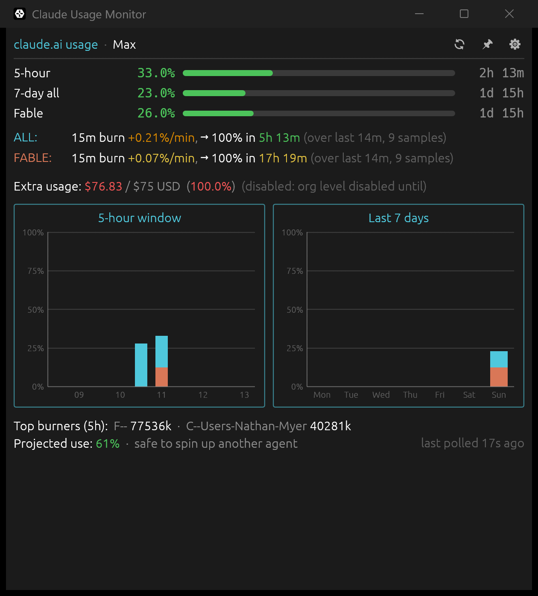
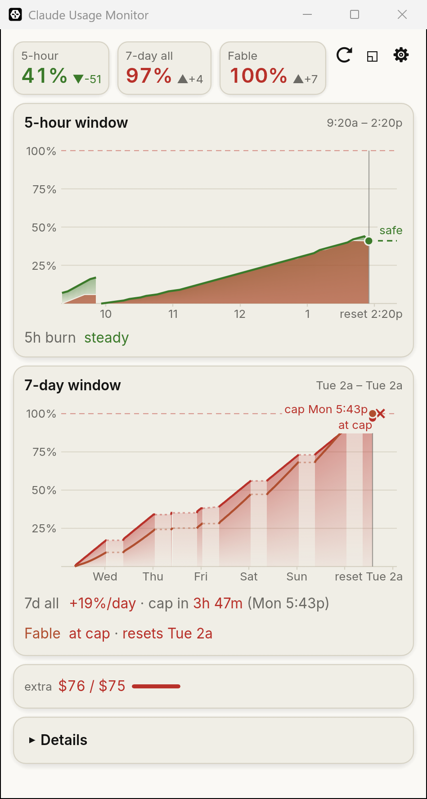

# claude-usage-monitor

A small desktop widget that shows your Claude plan usage in real time, for every Claude Code account on the machine at once. It signs in with the OAuth token Claude Code already keeps and polls the usage endpoint behind Claude Code's `/usage` (`https://api.anthropic.com/api/oauth/usage`), so the numbers you see are the ones Anthropic uses to enforce your caps, across Claude Code, Cowork, web chat, and any other surface that draws from the same pool.

Each Claude Code config directory (`~/.claude`, and any `~/.claude-*` you use with `CLAUDE_CONFIG_DIR`) is a **profile**. The app finds them on its own and polls all of them together; see [Accounts](#accounts-claude-code-profiles).

Written in Rust with [egui](https://github.com/emilk/egui). It ships two binaries: `claude-usage` (the GUI) and `claude-usage-cli` (a one-shot text report, a diagnostic dump, and an MCP server so Claude can check its own usage).



## What it shows

The window opens at 420x760 (minimum 360x320) in a warm dark theme. With one account it looks as below; with several, see [Several accounts](#several-accounts). From top to bottom:

- **Stat chips**: one chip each for the 5-hour window, the 7-day window (all models), and Fable when the API reports it. Each shows the utilization (rounded down, so 99.6% never reads as the cap) in its state color: green below 50%, yellow from 50%, orange from 75%, red from 90%. Next to it is the **pace**: utilization minus the share of the window that has elapsed, so `▲+6` means you are 6 points ahead of an even burn that would land exactly at 100% at the reset, and `▼-4` means 4 points behind. The delta is muted unless it is 10 points or more either way (ahead in amber, behind in green). Hover a chip for the reset time and the pace in words. To the right are three buttons: refresh now (⟳, rests 5 s after a click), pill mode (◱), and Settings (⚙).
- **5-hour window** (the hero timeline, titled with the window's span, "6:10p – 11:10p"): the current 5-hour window, from its start to the reset, on a 0–100% scale.
  - The 5-hour utilization as a filled area drawn from the saved samples, in the current state color.
  - The Fable share as a clay layer at the bottom of the area.
  - A "now" marker, and a dashed projection from now at the 15-minute burn rate. If the projection reaches 100% before the reset, a red ✕ marks the cap with its time ("cap 4:10p"); otherwise the line ends at the reset with a green "safe". A dashed line marks the 100% cap.
  - Stretches with no samples (the app was closed, the laptop slept) are bridged with a faint dotted line instead of leaving a hole. A reset still breaks the line.
  - Hover for a crosshair with the time, the utilization and the Fable share; past "now" it shows the projected value.
  - **5h burn** under the chart: the 15-minute rate for all usage ("+0.21%/min") and either "cap in 1h 48m" or "safe until reset". Hover for the full burn line. The rate is available right after a restart, because it is seeded from the saved history.
  - **After a reset** the chart starts over. Once a 5-hour window ends, the API reports 0% and no reset time until your next message starts a new window. Meanwhile the chart is empty (no times, now marker or projection) with "No active window · starts with your next message", the burn row reads "idle", and the 5-hour chip shows 0% with no pace. The same happens as soon as the reset time passes, without waiting for the next poll. The new window's chart begins at its start with only its own samples. In the rare case the API reports usage without a reset time, the chart shows the last 5 hours up to "now", from the latest reset on.
- **7-day window** (a second timeline, titled with the weekly window's span, "Tue 2a – Tue 2a"): the current weekly window from its start to the weekly reset, drawn like the 5-hour one, because the weekly limits often run out first.
  - The 7-day utilization (all models) as a filled area in its state color, and Fable's own 7-day limit as a clay line (hidden until Fable shows usage or a reset time).
  - A tick at each local midnight, labelled with the weekday, and "reset Tue 2a" at the end. With no known reset it shows the last 7 days up to now.
  - A "now" marker with a dot per limit, and a dashed projection per limit from its weekly rate (below): to 100% with a ✕ and "cap Mon 10:45a" (7-day all in its state color, Fable in clay) when it caps before the reset, else to the projected % at the reset with "safe". When the cap is too close to now for its label, only the ✕ shows; a limit already at 100% gets a ✕ on the 100% line at now. The labels keep clear of each other, the ✕ marks and the dots.
  - Gaps of more than an hour (the app was closed) stay solid when the value is the same at both ends (nothing was used meanwhile), and are bridged with a faint dotted line when it changed.
  - Both timelines draw their lines through the moments each whole percent was first seen (the API reports whole percents), straight in between (but never more than a point away from the reading, so a jump after a quiet stretch isn't spread across it) and flat after the latest one, instead of as steps. Hover shows the real readings. Nothing extra is stored for this.
  - Hover for "Sat 3:12p · 7d all 41% · Fable 52%"; past "now", the projected values.
  - **Weekly projections**: each limit's dashed line comes from its rate per day over the last 24 hours, measured from the latest sample at or before then (when that sample is older because the app was closed, the rise is spread over the whole gap; if the samples since then span 6 hours or more and rise faster, that faster rate is used instead), only since the weekly reset if that is later, and projected to that limit's reset. A short stretch of samples is never spread over less than 6 hours. With too little history there is no projection. The cap time counts from the last good poll.
- When the window is wide (a content column of 640 pt or more; the column grows to 1000 pt), the two timelines sit side by side, half each, and both cards end level. Narrower, they stack.
- **Extra**: credits used against your monthly limit as a small gauge ("$23 / $35"), when extra usage is set up. Hover for the details, including why extra usage is disabled if it is.
- **Details** (click to expand; it stays open or closed across restarts):
  - The other usage windows (per-model caps beyond Fable). Windows at 0% are hidden unless "Show all buckets" is on.
  - The ALL and FABLE burn lines in full, and the projected-use advice ("safe to spin up another agent").
  - The week's usage by surface (Claude Code, Cowork, chat, ...), when the API reports the breakdown.
  - **Top burners**: the projects using the most tokens in the current 5-hour window, attributed from the profile's local Claude Code session logs (`<config dir>/projects/`) and Cowork's (`~/Library/Application Support/Claude/local-agent-mode-sessions/` on macOS, `%APPDATA%\Claude\local-agent-mode-sessions\` on Windows). Cowork files its sessions under the account's id, so they count for the profile signed in to that account (sessions of no known account count for the default profile). A project is named after the last folder of the working directory recorded in its session log.
  - The plan label, how long the account's token is still valid, and how long ago the last poll was.
- **Errors**: a failed poll shows a banner above the last good data, which stays visible: "work — token expired" with the fix underneath ("token expired — run Claude Code in ~/.claude to refresh"). That account's data is dimmed with a "stale" badge until a poll succeeds again; hover the badge for the error. See [Accounts](#accounts-claude-code-profiles).

Numbers and bars glide to their new values on each poll, and the projection draws itself in. When the 5-hour window reaches 90%, its chip breathes three times and then holds a red outline and glow; it re-arms once usage drops below 88% or a new window starts.

The window's size, position, maximized state and mode (full or pill), the theme, the Details state, and your settings persist across restarts.

The theme is dark by default, and a light "cream" theme is built in:



Switch between them (or follow the system) with **Theme** in [Settings](#settings).

### Several accounts

With two or more profiles polled, everything above shows all of them at once, in the order set in Settings → Accounts, each in its own series color (blue, violet, teal, ...; also chosen there):

- **Chips** are grouped per account: a colored dot and the account's label over its 5-hour, 7-day and Fable chips. The chips keep their state colors, so the account color and the level never compete. Only the 5-hour chip of the account nearest its cap pulses.
- **Both timelines** overlay the accounts over the union of their windows: each account's line in its color with a light tint under it, a legend in the card's title row, and each account's reset as a colored mark on the time axis. Hover lists every account's value at that moment. The 5-hour Fable share layer is left out; on the 7-day chart each account's Fable line is dashed in its color. The 5-hour burn rows are grouped under each account's name.
- **Details** has one section per account.
- An account whose last poll failed keeps its last good data, dimmed and badged "stale".

Labels default to the email's local part (at most 16 characters) or, without one, the config directory's name; rename them in Settings → Accounts.

## Pill mode


A compact 300x44 always-on-top bar for parking in a screen corner: a ring and the 5-hour percentage, the time to reset ("5h · 3h55m", or "5h · 10m" under an hour; "5h · idle" between windows), the pace, and a state dot. The dot is hollow while polls fail or before the first data, and pulses at 90% like the chip.

With two or more accounts the pill widens to one segment per account, split by a hairline: a ring in the account's color, its 5-hour % in the state color, and the countdown (no pace, to keep it compact). The ring of the account nearest its cap breathes at 90%; a stale account's segment is dimmed.

- **Enter** it with the ◱ button in the header, or the tray menu's **Pill mode**. Settings → **Start in pill mode** opens the app as the pill every time.
- **Leave** it with a click on the pill; the full window comes back at its old place and size (maximized, if it was).
- **Drag** anywhere on the pill to move it. The full window and the pill remember their positions separately, and the pill reopens where you left it.
- **Right-click** swaps the pill's content for a row of actions: Expand, Refresh, Settings, Quit. Esc, a click on the background, or clicking another window closes the row.
- **Hover** for a two-line summary: the 5-hour window with its pace and reset, then the 7-day and Fable figures (or "Last poll failed").

## Menu bar (macOS) and tray icon (Windows)

**macOS.** With **Show menu-bar item** on (the default), the menu bar shows every account's 5-hour percentage as text, in account order: "46 · 12" ("–" for an account with no figure yet). It keeps updating while the window is hidden.

- **Click** it for the menu: Show / Hide, Pill mode (checked while in the pill), Refresh now, and Quit.
- **Close to menu bar**: while the item is on and **Close button hides to menu bar** is ticked (the default), the window's red close button hides the window instead of quitting. Polling and the menu-bar figures keep running.
- **Bring it back** with Show in the menu, or by reopening the app: click its Dock icon, switch to it with Cmd+Tab, or launch it again.
- **To quit**, use **Quit** in the menu or in the pill's right-click row, or untick **Close button hides to menu bar** and close the window.

**Windows.** With **Show tray icon** on (the default), the notification area shows a rounded square with a 5-hour percentage in two digits ("08", "46"), colored by state; "!!" means 100% or more and "–" means no data yet. With several accounts it shows the account with the most headroom (the lowest 5-hour %), so it tells you whether there is an account left to work in. Its tooltip reads "Claude usage · 5h 46% · resets 3:42 PM" (no reset between windows), plus "last poll failed" while polls fail; with several accounts, "Claude usage" and then a line per account ("work 46% · resets 3:42 PM", marked "stale" when its last poll failed). The icon keeps updating while the window is hidden.

- **Left-click** hides the window or brings it back.
- **Right-click** opens the menu: Show / Hide, Pill mode (checked while in the pill), Refresh now, and Quit.
- **Close to tray**: while the tray icon is on and **Close button hides to tray** is ticked (the default), the window's ✕ button and Alt+F4 hide the window instead of quitting. Polling, the icon and alerts keep running.
- **To quit**, use **Quit** in the tray menu or in the pill's right-click row, or untick **Close button hides to tray** (or **Show tray icon**) and close the window.

## Alerts

On Windows, the app sends a notification when an account's 5-hour window:

- reaches 75%,
- reaches 90%,
- is projected to hit the cap before the reset, at least 10 minutes ahead.

Every account is checked on its own, and each alert fires at most once per account per 5-hour window, including across restarts. With several accounts the title names the account ("work — 5-hour usage at 80%"). Each alert has its own toggle in Settings → Alerts, and **Send test notification** there shows a sample right away.

Notifications appear under the name **Claude Usage Monitor** with a coral "%" icon, in the notification banner and in the notification center. With Windows' **Do not disturb** on, they go to the notification center without a banner. To make the toasts carry that name, the app registers itself under an explicit AppUserModelID (see [Privacy & security](#privacy--security)). That ID also groups the taskbar button, so if you pinned `claude-usage.exe` to the taskbar before this version, the old pin may not group with the running window: unpin it and pin the running window again.

Clicking a notification is meant to bring the window forward, but this has not been confirmed yet (see [Known limitations](#known-limitations)).

## Settings

Open Settings with ⚙. Changes take effect on **Apply**, except **Always on top** and **Theme**, which apply at once.

- **Plan label**: shown in the Details footer line (default "Max").
- **Poll interval**: default 60 s, minimum 5 s. It accepts plain seconds or a suffix: `30`, `30s`, `2m`, `1h`.
- **Show all buckets**: list usage windows at 0% in Details too.
- **Always on top**: keep the full window above other windows. (The pill is always on top.)
- **Theme**: **System**, **Dark** (the default) or **Light**.
- **Accounts**: one card per profile, in display (and poll) order:
  - the account **color** (six swatches), **Enabled** (unticked: not polled or shown), and ▲ / ▼ to reorder;
  - the **label** (blank: from the account's email);
  - the config directory, the Keychain service it reads, and a status line ("me@example.com · token valid 3h", or the last error in red, with the full message on hover);
  - **Advanced → Keychain service override**, for a credential stored under a service name the app does not derive (blank: derived from the folder).

  Under the cards, **Add folder** adds a config directory by hand (for one outside `~/.claude-*`; such a card has **Forget** to remove it), and **Rescan** looks for new folders now. Discovered profiles appear on their own; to drop one for good, untick **Enabled** (it would otherwise be rediscovered).
- **Window**: **Show menu-bar item** / **Show tray icon**; **Close button hides to menu bar** / **to tray** (needs the item or icon); **Start in pill mode**.
- **Alerts** (Windows only; elsewhere they have no effect): **5-hour window reaches 75%**; **5-hour window reaches 90%**; **Projected to hit the cap before reset**; **Send test notification**.
- **Motion**: **Reduce motion** (values snap instead of gliding, and the near-cap chip holds steady instead of pulsing); **Keep pulsing near cap** (the chip and pill dot keep breathing for as long as the 5-hour window is at 90% or more, instead of three breaths. It repaints about 10 times a second, which costs a few percent of a CPU core while it lasts: about 9% of one core in testing at an earlier 15 times a second, against about 2.5% when idle).

## Install

You need a Rust toolchain ([rustup](https://rustup.rs)). The project is built with Rust 1.96 or later and runs on macOS and Windows; Linux builds (without the tray, alerts and rounded pill corners) but is untested.

```bash
git clone <this repo>
cd claude-usage-monitor
cargo build --release
```

The binaries land in `target/release/`: `claude-usage` (GUI) and `claude-usage-cli` (CLI), with `.exe` on Windows. If you have [just](https://github.com/casey/just), the justfile wraps the common commands:

```bash
just start        # build (release) and run the GUI; `just run` is an alias
just cli once     # run the CLI with arguments: once | debug | mcp
just mcp          # run the MCP server on stdio, for testing
just test         # cargo test
just lint         # cargo clippy --all-targets -- -D warnings
```

Before the first run, sign in to Claude Code (next section).

## Accounts (Claude Code profiles)

The app has no login of its own: it uses Claude Code's. Run `claude` and sign in with `/login` (a Pro or Max subscription), and the app picks the account up on its next poll.

**Which folders count.** A profile is a Claude Code config directory that is signed in:

- `~/.claude`, the default (its account is in `~/.claude.json`), and
- every `~/.claude-*` directory whose own `.claude.json` has a signed-in account (`oauthAccount`), such as `~/.claude-work` used with `CLAUDE_CONFIG_DIR=~/.claude-work claude`. A `~/.claude-*` folder without one (a sync folder, say) is skipped.

Folders signed in to the same account count once (the first wins). The app looks again on every poll, so a new folder appears without a restart; **Rescan** in Settings looks right away, and **Add folder** takes a directory elsewhere. A profile's id is the folder's name without the dot (`~/.claude-work` → `claude-work`; `~/.claude` → `default`).

To add a second account:

```bash
CLAUDE_CONFIG_DIR=~/.claude-work claude   # then /login with the other account
```

**Where the token comes from.**

- **macOS**: the login Keychain, where Claude Code keeps it, read with `/usr/bin/security find-generic-password`. The default profile's item is `Claude Code-credentials`; another folder's is `Claude Code-credentials-<8 hex>`, the first 8 hex digits of the SHA-256 of the exact `CLAUDE_CONFIG_DIR` value (for example `/Users/me/.claude-work`). If the Keychain has no item, the app falls back to `<config dir>/.credentials.json`.
- **Windows and Linux**: `<config dir>/.credentials.json`.

**The Keychain prompt (macOS).** The first time the app reads a profile's item, macOS asks whether `security` may access "Claude Code-credentials…". Click **Always Allow**: plain **Allow** works too, but asks again the next time the app re-reads the token (when it expires or Claude Code rotates it). There is one item, so one prompt, per profile. While a prompt is waiting, only that profile's poll waits; the others keep going. A denied or failed read shows as "not signed in", with the reason.

**Read-only tokens.** The app never refreshes, rotates or writes a credential; that is Claude Code's job, and doing it here could sign Claude Code out. Claude Code's access tokens last a few hours and are refreshed whenever Claude Code runs. So:

- When a profile's token has expired, the app makes no request and shows "token expired — run Claude Code in ~/.claude-work to refresh". Start `claude` in that profile (`CLAUDE_CONFIG_DIR=~/.claude-work claude`) for a moment, and the next poll picks the new token up. Meanwhile the last good data stays on screen, marked stale.
- If the API rejects a token (401), the app reads the credential again once; if Claude Code has stored a newer one, it retries with it, otherwise it shows the same message.
- Settings → Accounts shows how long each token is still valid.

A rate limit (429) pauses that profile's polling for the `Retry-After` time, or two poll intervals without one.

## CLI

```bash
claude-usage-cli once                       # poll every enabled profile, record it, print a text report per profile
claude-usage-cli once --profile work        # only one profile (its id, label or config dir)
claude-usage-cli once --plan "Max 5x"       # plan label in the titles (default: the GUI's setting)
claude-usage-cli once --show-all            # include 0% windows
claude-usage-cli debug                      # diagnose every profile's folder, credential and endpoint
claude-usage-cli debug --profile work
claude-usage-cli mcp                        # MCP server on stdio (see below)
```

`once` prints one section per profile:

```
── me (default, me@example.com) ──
Claude usage  ·  Max

5-hour           13.0%  resets in 1h 49m
7-day all        11.0%  resets in 5d 9h
...

── work (claude-work, me@work.example) ──
Claude usage  ·  Max
...
```

It goes through the same code path as the GUI's poller: it appends to each profile's `history.jsonl` and rewrites its `latest.json`, so it also refreshes the data the MCP server reports. It reads the GUI's saved settings (which profiles are disabled, labels, Keychain overrides, the plan label) and exits non-zero if any profile failed; an unknown `--profile` lists the valid ids and exits with 2.

`debug` prints a table with one row per profile (id, config dir, Keychain service, whether the credential is present, when it expires, email, account id, the newest session log, and the HTTP status of one request to the usage endpoint), then one recommendation per profile ("OK", or what to run, such as ``token expired or rejected — run `CLAUDE_CONFIG_DIR=/Users/me/.claude-work claude` once so Claude Code refreshes it``). It never prints a token. On macOS it reads the Keychain, so it can bring up the Keychain prompt.

The poll interval is a GUI setting (Settings → Poll interval, default 60 s, minimum 5 s). It accepts plain seconds or a suffix: `30`, `30s`, `2m`, `1h`.

## MCP server (let Claude check its own usage)

`claude-usage-cli mcp` is an [MCP](https://modelcontextprotocol.io) server on stdio that lets a Claude instance (Claude Code, Claude Desktop, …) read your current usage and throttle itself when you're near a cap. It does **no** network or auth of its own. It reports what the stats were at the most recent poll, read from each profile's `latest.json`, so **the GUI must be running** (or something must run `claude-usage-cli once` regularly) to keep the data fresh.

Tools:

- **`get_usage()`**: non-blocking. Leads with the **calling profile** (the account this Claude Code session runs under, see below): each window's utilization, reset time, and time to reset, plus the data's age, a `stale` flag (true if the monitor isn't updating), the extra-usage block, the week's per-surface breakdown, and a `recommendation`/`summary`. Then:
  - `profile`: which profile the top-level fields describe, `{"id", "label", "email", "config_dir"}`;
  - `other_profiles`: every other known profile, each with its own `profile` and the same fields;
  - `profile_note`: only when the server's `CLAUDE_CONFIG_DIR` matches no known profile; it says so, and the top-level fields are the default profile's.
- **`wait(seconds, confirm)`**: throttle by sleeping. It blocks for at most ~50 s per call, then returns how much time remains until the calling profile's 5-hour reset and whether to call again, so a long wait is done as several short cycles. Call with `confirm=false` first to preview (nothing sleeps); `confirm=true` waits one cycle. Loop until `done` is true.
- **`wait_test(seconds)`**: diagnostic only. Blocks for the full requested duration (up to a 600 s ceiling) and reports how long it actually slept, so you can find your client's real tool-call timeout. If it returns, the limit is at least that long; if the client kills it first, you've found the ceiling. Then set `CLAUDE_USAGE_MCP_MAX_BLOCK` just under it.

**The calling profile.** Claude Code passes its environment to the MCP servers it starts, so the server sees the session's `CLAUDE_CONFIG_DIR`. The server matches it against the profiles the monitor knows (from `profiles.json`; trailing `/` ignored, `~` expanded, symlinks resolved); unset means the default profile. An agent in `CLAUDE_CONFIG_DIR=~/.claude-work claude` therefore gets the work account's usage first, and can see in `other_profiles` whether another account has headroom.

Why the short cycles: most MCP clients inherit a ~60 s request timeout (Claude Desktop hard-codes it and silently drops later results), so a single multi-minute block would be killed. Bounded cycling is timeout-proof and never traps the agent.

### Registering it

**Claude Code (recommended).** Register the binary by absolute path so it works from any directory:

```bash
claude mcp add --scope user claude-usage -- /absolute/path/to/claude-usage-monitor/target/release/claude-usage-cli mcp
```

On Windows the path is `C:\absolute\path\to\claude-usage-monitor\target\release\claude-usage-cli.exe`. A user-scope server is stored in the profile's own config, so register it once per profile you use: `CLAUDE_CONFIG_DIR=~/.claude-work claude mcp add --scope user claude-usage -- ...`.

**Claude Code, project scope.** The repo ships a `.mcp.json` that runs `target/release/claude-usage-cli mcp`. The path is relative, so it works only after `cargo build --release` and only when Claude Code runs from the repo root; started from a subdirectory, the server fails to launch. Approve the `claude-usage` server when asked and check it with `/mcp`.

**Claude Desktop.** Add to `claude_desktop_config.json`:

```json
{
  "mcpServers": {
    "claude-usage": {
      "command": "C:\\absolute\\path\\to\\claude-usage-monitor\\target\\release\\claude-usage-cli.exe",
      "args": ["mcp"]
    }
  }
}
```

### Tuning

Set these in the `env` block of your MCP server config:

| Variable | Default | Meaning |
|---|---|---|
| `CLAUDE_USAGE_MCP_MAX_BLOCK` | 50 | Max seconds per `wait` cycle. Keep it under your client's tool timeout. |
| `CLAUDE_USAGE_MCP_STALE_AFTER` | 180 | Seconds before a snapshot is flagged stale. |
| `CLAUDE_USAGE_MCP_TEST_MAX_BLOCK` | 600 | Hard ceiling for `wait_test`. |

A value that isn't a whole number does not stop the server: it falls back to the default and prints a note to stderr. The two block limits are raised to at least 1.

## Recommended layout

Snap the window to a corner of your screen and turn on **Always on top** in Settings, or switch to [pill mode](#pill-mode), which always stays on top. With close to the menu bar (or tray) on, the close button tucks it away and the menu bar (or tray icon) keeps showing the 5-hour percentage. Pair it with [`claude-monitor`](https://github.com/Maciek-roboblog/Claude-Code-Usage-Monitor) for a complete picture: `claude-monitor` shows local per-instance attribution from Claude Code logs; this widget shows the unified server-side meter that's actually about to gate you.

## When it breaks

Run `claude-usage-cli debug` first. It shows every profile it found with its config dir, Keychain service, credential and token expiry, account, newest session log and the result of one request to the usage endpoint, then what to do for each (see [CLI](#cli)). You can probably have Claude Code fix things if you feed it this output; it contains no tokens.

Common failure modes:

- **"token expired — run Claude Code in ~/.claude-work to refresh"**: the profile's access token has run out (or the API rejected it) and the app does not refresh tokens. Run `claude` in that profile (`CLAUDE_CONFIG_DIR=~/.claude-work claude`; plain `claude` for `~/.claude`) and the next poll recovers.
- **"no Claude Code login found in ~/.claude-work — run `claude` and sign in"**: no credential in the Keychain item or `.credentials.json`. Sign in with `/login` in that profile. On macOS the reason in parentheses may also say the Keychain read was denied or failed: allow it at the next prompt (choose **Always Allow**), or check that the item exists in Keychain Access (search "Claude Code-credentials").
- **A profile is missing**: its folder has no `.claude.json` with a signed-in account yet (sign in there), or it is outside `~/.claude-*` (use **Add folder** in Settings → Accounts), or it was disabled (tick **Enabled** again).
- **The Keychain prompt keeps coming back**: it was answered with **Allow** rather than **Always Allow**; answer **Always Allow** once.
- **"rate limited"**: the usage endpoint answered 429. That profile waits as told (or two poll intervals) and tries again; raise the poll interval if it keeps happening.
- **"poller stopped"** in the GUI: the background poller exited unexpectedly. Restart the app.
- **The GUI closed or showed a "crashed" message box**: the details are in `crash.log` in the [data directory](#privacy--security), with a backtrace for a panic. Panics the poller recovers from are logged there too, without a message box. If the tray icon or the notification registration fails, the reason is logged there as well, as a plain entry without a backtrace.
- **The window seems gone**: with close to the menu bar or tray on, closing only hides it. On macOS click the Dock icon or use Show in the menu-bar item; on Windows left-click the tray icon (it may be in the taskbar's "^" overflow).

## Privacy & security

The app reads Claude Code's OAuth access token for each profile, which is effectively a password for that account. It sends it only to `api.anthropic.com`, as the `Authorization` header of the usage request; it never writes it to disk, logs it, shows it, or puts it in an error message, and it does not keep the refresh token at all. It never refreshes, rotates or changes the stored credential. `debug` prints no token.

A small amount of state is kept locally in the app's data directory:

```
claude_usage_tui/
├── profiles.json                 the known profiles: id, label, color, config dir, email, account id (no tokens). Read by the MCP server.
├── profiles/
│   ├── default/
│   │   ├── history.jsonl         usage snapshots (percentages and timestamps; no conversation content), for the charts and the burn rate
│   │   └── latest.json           the most recent full snapshot (every window's utilization and reset time, the extra-usage block, the weekly breakdown). Read by the MCP server.
│   ├── claude-work/              the same, per profile
│   └── .legacy-migrated          marks the one-time migration below as done
├── history.jsonl, latest.json    from versions before profiles; left in place, no longer written
├── crash.log                     (GUI) panics (with a backtrace), startup failures, and tray icon or notification registration failures, each with a timestamp
└── app-icon.png                  (GUI, Windows) the coral "%" icon that notifications show, rewritten only when it changes
```

- **Migration**: on its first start, this version copies (not moves) the root `history.jsonl` and `latest.json` into `profiles/default/`, if that profile has none yet, and writes `profiles/.legacy-migrated`. The originals stay where they are and can be deleted once you are happy. An `anonymous_id` file from earlier versions is no longer used and can be deleted too.
- **Account change**: if a config directory is signed in to a different account than before, its `history.jsonl` is renamed to `history.<first 8 characters of the old account id>.jsonl` and the profile starts a fresh history, so two accounts' usage never mix on one chart.

The data directory is:

- Windows: `%APPDATA%\claude_usage_tui\`
- macOS: `~/Library/Application Support/claude_usage_tui/`
- Linux: `$XDG_DATA_HOME/claude_usage_tui/` (default `~/.local/share/claude_usage_tui/`)

This is the same directory the Python version used with python.org (non-Store) Python, so that history carries over as is. If you ran the Python version with Microsoft Store Python, see [Migrating history from the Python version](#migrating-history-from-the-python-version).

The GUI's settings (everything in the [Settings](#settings) panel, including the Accounts list: each profile's id, config dir, label, color, enabled flag and Keychain override), its window state (full-window and pill positions, size, maximized, current mode, Details open or closed), each profile's alert state, and the theme are stored in eframe's `app.ron`. Settings saved by a version from before profiles still load; their cookie-file and client-SHA entries are ignored and dropped on the next save. `app.ron` lives at:

- Windows: `%APPDATA%\claude-usage\data\app.ron`
- macOS: `~/Library/Application Support/claude-usage/app.ron`
- Linux: `$XDG_DATA_HOME/claude-usage/app.ron` (default `~/.local/share/claude-usage/app.ron`)

The app keeps its own window geometry inside the `"settings"` entry. On the first start of this version it removes the old `"window"` entry that earlier versions let eframe write, so a stale size from before cannot override it.

On Windows the GUI also creates one per-user registry key, `HKCU\Software\Classes\AppUserModelId\ClaudeUsageMonitor`, with the values `DisplayName` ("Claude Usage Monitor") and `IconUri` (the path of `app-icon.png`). Windows uses it to label the app's notifications. The app rewrites it on every start; it needs no admin rights, and you can delete it after removing the app. Windows' own notification settings for the app live under `HKCU\Software\Microsoft\Windows\CurrentVersion\Notifications\Settings\ClaudeUsageMonitor`.

## Changes from the Python version

This project used to be a Python terminal dashboard (`claude_usage_tui.py`). The Rust port keeps the same numbers, history format and MCP tools. It no longer reads `claude.ai` browser cookies (nor needs the web client's build hash): it uses Claude Code's own sign-in and the OAuth usage endpoint, and polls every Claude Code profile instead of one browser session. It also drops `--no-fullscreen`, which only made sense for the terminal UI.

Other differences: `--once` and `--debug` became the `once` and `debug` subcommands of `claude-usage-cli`; the poll interval and plan label are set in the GUI's Settings instead of on the command line; and the GUI replaces the terminal's bar charts with the two timelines and the chips described in [What it shows](#what-it-shows).

### Migrating history from the Python version

With python.org Python, the Python version wrote `history.jsonl` to `%APPDATA%\claude_usage_tui\`, the directory the Rust app uses, and the app copies it into the default profile on its first start (see [Privacy & security](#privacy--security)), so there is nothing to do.

Microsoft Store Python virtualizes `%APPDATA%`: the Python version's files actually landed in

```
%LOCALAPPDATA%\Packages\PythonSoftwareFoundation.Python.<version>_<id>\LocalCache\Roaming\claude_usage_tui\
```

and the Rust app does not see them. To keep your chart history, merge that `history.jsonl` into the default profile's, `%APPDATA%\claude_usage_tui\profiles\default\history.jsonl`. Both versions use the same one-JSON-object-per-line schema. Close the GUI and any Python monitor first, then run in PowerShell:

```powershell
# The Store Python file (if you have several Python versions installed, set $old by hand).
$old = Get-ChildItem "$env:LOCALAPPDATA\Packages\PythonSoftwareFoundation.Python.*\LocalCache\Roaming\claude_usage_tui\history.jsonl" |
    Select-Object -First 1 -ExpandProperty FullName
$new = "$env:APPDATA\claude_usage_tui\profiles\default\history.jsonl"

New-Item -ItemType Directory -Force (Split-Path $new) | Out-Null
if (Test-Path $new) { Copy-Item $new "$new.bak" }   # backup of the destination

# Old rows plus new rows, blank lines dropped, sorted by timestamp, written as UTF-8 without BOM.
$lines = (@(Get-Content $old) + @(if (Test-Path $new) { Get-Content $new })) | Where-Object { $_.Trim() }
$sorted = $lines | Sort-Object { [double]([regex]::Match($_, '"ts":\s*([-0-9.eE+]+)').Groups[1].Value) }
[IO.File]::WriteAllLines($new, [string[]]$sorted, (New-Object Text.UTF8Encoding $false))
```

It leaves the Store Python file untouched, and `history.jsonl.bak` holds the previous destination if you need to undo. Run it once: running it again duplicates the old rows.

## Known limitations

- **Clicking a notification** is wired to bring the window forward, but this has not been confirmed on a real banner yet. It may not work from the notification center after the banner is gone, and Windows may show the window without focusing it.
- **Windows only**: alerts and the rounded pill corners. macOS has the menu-bar item instead of the tray icon; Linux builds without either (and is untested in general).
- **This version was developed and checked live on macOS.** The Windows build compiles (it is cross-checked, including clippy), but the profile-based version has not yet been run on Windows.
- **The screenshots** show a single account.

## Caveats

This app polls an undocumented endpoint (the one Claude Code's `/usage` uses) with Claude Code's own credential. Anthropic could change either at any time, and the app would stop working until updated.

This is a personal tool, not an Anthropic-supported integration. Use accordingly.

## License

MIT. See [LICENSE](LICENSE).
